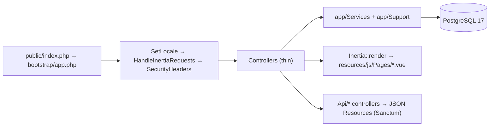

# Repository Guidelines

Recruivo — a hosted job board and candidate-management platform. One Laravel codebase serves two HTTP surfaces: a localized (en/fr) Inertia 3 + Vue 3 web app (the product) and a small Sanctum JSON API. License: PolyForm Strict 1.0.0, a source-available license (`composer.json`, `LICENSE`).

> This file is hand-maintained. `laravel/boost` (`boost.json`, `agents: ["codex"]`) can regenerate it and the previously committed auto-generated block was stale (it claimed PHP 8.2 / Laravel 12 / `.ai/rules` / Laravel Cloud). Facts here are verified against the repo; keep them that way.

## Project Overview

- Job board: public job/company browsing and search, candidate applications and profiles, recruiter job/application management, admin back office, notifications, demo mode, backups.
- Three roles, spatie/laravel-permission: `Admin`, `Recruiter`, `Candidate`.
- No billing or AI module. Search is hand-rolled in PHP (`SmartSearchService`) — Scout is **not** installed.
- Two deployments from one image: production `recruivo.tech` (`APP_ENV=production`) and demo `demo.recruivo.tech` (`APP_ENV=demo`, mail logged, `APP_IS_DEMO=true`), isolated compose projects/volumes/Redis.
- The compose files and CI workflow exist to run **this** service — `README.md:148` states "The project is a hosted service, not a self-hosting kit." Do not frame the stack as a supported way for third parties to self-host.

## Architecture & Data Flow

- **No `app/Http/Kernel.php`, no `app/Console/Kernel.php`.** `bootstrap/app.php` owns routes, middleware, cookie encryption exceptions, trustProxies/Hosts and the `role`/`guest`/`verified` aliases; `routes/console.php` owns the entire schedule. App providers are listed in `bootstrap/providers.php` (`AppServiceProvider`, `AuthServiceProvider`); the framework's own providers come from `ServiceProvider::defaultProviders()`, which a `config/app.php` list would replace rather than extend.
- Web routes are locale-prefixed: `routes/web.php` wraps everything in a `{locale}` group (`en|fr` from `config/locales.php`). `app/Http/Middleware/SetLocale.php` is *prepended* and sets the unencrypted `locale` cookie; `HandleInertiaRequests` and `SecurityHeaders` are *appended* on the web group.
- Controllers stay thin. Business logic lives in `app/Services`; Inertia card shapes live in `app/Support` (`JobCardSerializer`, `CompanyCardSerializer`). API responses use `app/Http/Resources`.
- Web and API controller trees duplicate domain operations (recorded in `CONTEXT.md`, 2026-09-01). When changing a domain rule, update both trees.
- Queues: no domain job is dispatched. All 9 `app/Notifications/*` implement `ShouldQueue`; `app/Jobs/QueueHeartbeat.php` is queued by the scheduler only. No custom events/listeners — the only event is Laravel's `Verified` in `routes/web.php`.
- Schedule (`routes/console.php`): `demo:reset`, `backup:clean|run|monitor`, `QueueHeartbeat` every 5m, `queue:health`.



Data flow specifics:

- Shared Inertia props come from `HandleInertiaRequests::share()`: `auth` (user + roles), `locale`, `translations` (both locales, built from `SHELL_TRANSLATION_SOURCES`), `flash`, `notifications`. There is **no Ziggy/Wayfinder** — Vue builds URLs with the local `localeUrl()` helper.
- Infinite lists use two patterns: native `<InfiniteScroll>` backed by `Inertia::scroll` + `ScrollPagination<T>` (`Pages/Jobs/Index.vue`, `Pages/Candidate/SavedJobs.vue`), and the `useLoadMore()` composable (most other lists).
- API: `routes/api.php` — public `GET /api/health` probe (used by compose healthcheck and deploy gate), throttled public reads (`throttle:api`), then `auth:sanctum` groups guarded by `role:` middleware. Bearer tokens via `createToken()`.
- Demo isolation: `APP_IS_DEMO` + `app/Http/Middleware/RefuseDemoMutations.php` make demo recruiter groups read-only; `User::deleting` blocks demo accounts; `demo:reset --force` reseeds the canonical dataset (triple guard: env ≠ production, env allowlist, DB-name allowlist).

## Key Directories

| Path | Purpose |
| --- | --- |
| `app/Models/` | `Job`, `Application` (+ `ApplicationStatusEvent` audit rows), `Company`, `CandidateProfile`, `User`, `Post` |
| `app/Services/` | `SmartSearchService` + `SearchEnvelope`, `UserRegistrationService`, `UserAccountDeletionService`, `ApplicationResumeService`, `AdminDashboardService`, `DemoAccountGuard`/`DemoContentService`, `UserAccountDeletionService` |
| `app/Support/` | `JobCardSerializer`, `CompanyCardSerializer`, `JobPostingSchema` (JSON-LD), `JobDescriptionFormatter`, `DynamicVite` |
| `app/Http/Controllers/` | `Controller.php` base + `Auth/`, `Candidate/`, `Recruiter/`, `Admin/`, `Api/{Admin,Candidate,Recruiter}`, `Api/Concerns/FormatsAuthenticatedUsers` |
| `app/Enums/` | String-backed: `JobStatus`, `ApplicationStatus`, `ItCategory`, …; consumed by validation and casts |
| `app/Policies/` | `JobPolicy`, `ApplicationPolicy`, … registered in `AuthServiceProvider` with an Admin `Gate::before` bypass |
| `app/Http/Requests/` | 9 FormRequests with role checks in `authorize()` and `__()` message keys |
| `app/Helpers/helpers.php` | Autoloaded via composer `files`: `localized_route()`, `pagination_payload()` |
| `routes/` | `web.php` (all pages), `api.php` (JSON), `console.php` (schedule) |
| `resources/js/` | `app.ts` (sole entry), `Pages/`, `Components/`, `Layouts/`, `composables/`, `types/index.ts`, `inertia.d.ts` |
| `resources/views/` | `inertia.blade.php` — **the only Blade shell**; owns server-rendered SEO/hreflang/JSON-LD |
| `resources/lang/` | `en/`, `fr/` (plus `*.json`) strings, and the shell dictionary in `HandleInertiaRequests` |
| `database/` | migrations, 6 factories, seeders (`RoleSeeder`, `JobSeeder`, `DemoContentService` dataset) |
| `config/` | `locales.php` (en/fr), `search.php` (scoring weights/synonyms/typo limits), `backup.php`, `app.php` env knobs |
| `tests/Feature/` | 50+ PHPUnit Feature tests (no unit tests) |
| `scripts/` | `backup.sh`, `restore.sh` (ops; `restore.sh` is destructive, needs `--force`) |
| `docker/` | `php/{php.ini,opcache.ini,php.dev.ini}`, `docker-entrypoint.sh`, `postgres/init/01-create-extra-databases.sql` |
| `.agents/skills/` | Laravel-authored Boost skills listed in `boost.json` (`laravel-best-practices`, `scout-development`, `tailwindcss-development`, `infer-conventions`) |

## Development Commands

**There is no host PHP.** Everything runs in the `development` image. The full local stack:

```bash
docker compose -f docker-compose.yml -f docker-compose.dev.yml up -d --build
docker compose -f docker-compose.yml -f docker-compose.dev.yml exec app php artisan migrate --seed
```

- **Always include the `docker-compose.dev.yml` overlay locally.** The base file points app/queue/scheduler at the private GHCR image, which cannot be pulled without credentials.
- Deployments (prod/demo) use two flags, both required: `APP_ENV_FILE=<file> docker compose --env-file <file> …`. `env_file:` feeds containers; `--env-file` feeds compose interpolation (`DB_HOST`, `REDIS_HOST`, `APP_PORT`, `COMPOSE_PROFILES`).
- Non-Docker workflow is also documented in `README.md` (~lines 96–114): `npm install`, `php artisan key:generate`, `migrate --seed`, `storage:link`, `php artisan serve` + `npm run dev`; set `QUEUE_CONNECTION=sync` or run `queue:work`/`schedule:work`.

Frontend:

```bash
npm run dev        # vite on 0.0.0.0:5173
npm run build      # writes public/build/manifest.json
npm run typecheck  # vue-tsc --noEmit
```

Quality gates (from `README.md:278-285`; CI runs the same commands without Docker):

```bash
docker compose -f docker-compose.yml -f docker-compose.dev.yml run --rm app php artisan test --compact
docker compose -f docker-compose.yml -f docker-compose.dev.yml run --rm app vendor/bin/pint --test
docker compose -f docker-compose.yml -f docker-compose.dev.yml run --rm app vendor/bin/phpstan analyse --memory-limit=512M
docker compose -f docker-compose.yml -f docker-compose.dev.yml run --rm app composer audit
bun run typecheck && bun run build
```

Ops / app commands: `php artisan demo:reset --force`, `php artisan make:admin --email=… --name=…`, `php artisan roles:backfill-legacy --dry-run`, `php artisan queue:health`, `APP_ENV_FILE=.env.production ./scripts/backup.sh`, `APP_ENV_FILE=.env.production ./scripts/restore.sh --force <dir|zip>`.

## Code Conventions & Common Patterns

- **PHP**: `^8.3`; explicit return types and parameter types everywhere; constructor property promotion with `readonly` for stateless services/serializers (usually `final`); PHP 8 curly braces for all control structures; `array<string, mixed>` PHPDoc shapes over inline comments; long "why" comments only for non-obvious decisions (`bootstrap/app.php`, `config/search.php`).
- **Naming**: PascalCase classes, camelCase methods, snake_case props/JSON keys, TitleCase enum cases, descriptive predicates (`isPubliclyVisible`, `isClosingSoon`, `applyStatusUpdate`).
- **Layering**: thin controllers → service/serializer (constructor-injected) → model. Reuse `JobCardSerializer`/`CompanyCardSerializer` for web card payloads and `Http/Resources` for API payloads; do not invent a third shape.
- **Validation**: FormRequests with `authorize()` role checks and `messages()` using `__()` keys. Inline `$request->validate()` only in API/Auth login and contact.
- **Authorization**: policies + `$this->authorize(...)` in web controllers; API controllers duplicate ownership checks via `abort_unless(...)` helpers (`authorizeJob()`). Admin bypass lives in `Gate::before`.
- **Errors**: `abort`/`abort_unless`, `ValidationException::withMessages`, 7 named rate limiters defined in `AppServiceProvider`. Avoid silent catches; no swallowing in services.
- **State/persistence**: bigint auto-increment ids everywhere except uuid `notifications`/`failed_jobs`; `citext` for `users.email`/`password_reset_tokens.email`; jsonb for translatable and candidate structured fields (`languages_data`, `profile_links`, `experiences`, `educations`, `preferred_categories`); `softDeletes` only on posts; unique `(candidate_id, job_id)` on applications; `Application::booted()` writes `ApplicationStatusEvent` rows on create/status change. `DB::transaction` only in `UserAccountDeletionService` — add one when a write spans tables.
- **i18n**: URL locale segment drives `App::setLocale`; always build links with `localized_route()`; new user-facing strings go in `resources/lang/{en,fr}` or controller-computed props. Never hardcode UI strings in Vue.
- **Frontend (contract-enforced, see `tests/Feature/FrontendArchitectureTest.php`)**: everything renders through `Inertia::render(...)` — no parallel Blade pages; all SFCs use `<script setup lang="ts">`; `resources/js/app.ts` is the single entry (no `app.js`/`bootstrap.js`, CSS imported by `app.ts`); relative imports (the `@/*` tsconfig path exists but Vite has **no** alias — it is inert); no `any`/`as any`/`as unknown as`; `postcss.config.js` stays JavaScript; Tailwind v3 + `@tailwindcss/forms` only, no component library.
- **Design system (`DESIGN.md`)**: dark-first (`<html class="dark">` unless the `recruivo:theme` cookie says light) — every surface/border/text utility needs a `dark:` counterpart on the same element; one amber accent (`#d97706`, theme-invariant) on stone neutrals; 5-step radius vocabulary; `min-h-11` touch targets; `gap`-based layout (not margins); `space-y-8` page rhythm; 72rem container (80rem admin).
- **SEO** is server-rendered in `inertia.blade.php` (title/meta/OG/canonical/hreflang derived from `$page['component']` + props, JSON-LD from `meta.structured_data`) because crawlers do not run JS; Vue pages only add client-side `<Head :title>`. Preserve both layers.

## Important Files

- `bootstrap/app.php` — the whole application wiring (routes, middleware, cookies, aliases). Start here.
- `routes/{web,api,console}.php` — page surface, JSON surface, schedule.
- `app/Providers/AppServiceProvider.php` — `DynamicVite`, rate limiters, reset-password URL.
- `app/Http/Middleware/{SetLocale,HandleInertiaRequests,SecurityHeaders,RefuseDemoMutations}.php` — locale, shared props, headers, demo read-only.
- `resources/views/inertia.blade.php` + `resources/js/app.ts` — the SPA shell (root view config lives in `HandleInertiaRequests::$rootView = 'inertia'`).
- `config/search.php` + `app/Services/SmartSearchService.php` — search tuning and ranking (one deep interface for search page + autocomplete).
- `phpunit.xml`, `phpstan.neon` + `phpstan-baseline.neon`, `pint` (dev dep), `vite.config.ts`, `tsconfig.json`, `tailwind.config.ts`, `Dockerfile`, `docker-compose*.yml`, `Caddyfile`, `.env.example`, `.github/workflows/ci.yml`.
- `CONTEXT.md` (domain glossary/decisions — read before changing search, job cards, resumes, roles) and `DESIGN.md` (design tokens/rules — read before touching UI).

## Runtime/Tooling Preferences

- PHP `^8.3` (image: `dunglas/frankenphp:1.12-php8.4-trixie`, ARG `PHP_VERSION=8.4`), FrankenPHP/Caddy on `:80` — **not** php-fpm; `ARG NODE_VERSION=22` in the builder stage. Compose deps: `postgres:17`, `redis:7-alpine` (+ `redis-demo`), mailpit/vite in dev; no search container.
- Extensions: bcmath, exif, gd, mbstring, opcache, pcntl, pdo_pgsql, zip, redis, plus `postgresql-client` 17 (`pg_dump` must match the server). Prod `opcache.validate_timestamps=0`; dev revalidates.
- JS: committed lockfile is `package-lock.json` and the Docker build uses `npm ci` (npm is the source of truth); CI uses Bun (`bun install`, `bun run typecheck|build`) and no `bun.lock` is committed. Use `bun` only where CI does.
- Static analysis: Larastan **level 5**, `paths: [app]`, carried by a ~158-entry `phpstan-baseline.neon` — prefer fixing over appending ignores. Pint: `vendor/bin/pint --test` in CI; fix with `vendor/bin/pint <files>`. **`--dirty` fails inside the image (git is absent)** — always pass changed files explicitly.
- Traps:
  - The long-running `recruivo-app-1` container bind-mounts a *different* checkout, so `docker exec recruivo-app-1 php artisan test` silently tests the wrong tree. Test a worktree with `docker run --rm --network … -v "$PWD:/var/www/html" … --entrypoint php <image> artisan test <paths>` and verify mounts with `docker inspect`.
  - `public/build/manifest.json` must exist or every Inertia page test 500s ("Vite manifest not found").
  - `storage/**` and `bootstrap/cache` must be writable and a `.env` or `DB_*` env vars must be present, otherwise tests are reported as PHPUnit *warnings* rather than passes.
  - Run tests **serially** in this worktree; `--parallel`/Paratest is unstable locally and leaves `recruivo_test_N` databases behind (CI does use `--parallel --compact`).
  - `restore.sh` is destructive and requires `--force`; `backup.sh` prunes old snapshots. Deviating from the documented invocation can touch production data.

## Testing & QA

- PHPUnit `^12` (no Pest), Paratest available. `tests/TestCase.php` is stock (framework TestCase + `CreatesApplication`); `tests/Concerns/CreatesRoleUsers.php` holds the shared role-user factories but there are **no** custom assertions — each class declares `use RefreshDatabase;` itself and re-seeds roles in `setUp()` (`Role::firstOrCreate(['name' => 'Candidate', 'guard_name' => 'web'])`).
- Layout: `tests/Feature/{Auth,Api,Api/Recruiter,Admin,Candidate,Recruiter,…}` mirrors the route surface; contract tests (`FrontendArchitectureTest`, `InertiaUiContractTest`, `SecurityAuditRegressionTest`, `ProductionReadinessTest`) pin toolchain/files/security regressions. `tests/Unit/` is empty.
- `phpunit.xml` forces `APP_ENV=testing`, `DB_CONNECTION=pgsql`, `DB_DATABASE=recruivo_test` (created by `docker/postgres/init/01-create-extra-databases.sql`), array cache/session/mail, `sync` queue, `BCRYPT_ROUNDS=4`. Never point it at a live database.
- Run: `php artisan test --compact [path]`, `--filter=<name>` for a single test. Add `--parallel --compact` only in CI.
- Conventions when writing tests:
  - Fixtures via factories with custom states (`User::factory()->for($company)`), `$this->faker->…` inside `definition()`, `fake()` inside `configure()`/state closures; `Notification::fake()` / `Storage::fake('private'|'public')` for side effects.
  - Assertions: `assertInertia(...)`, `assertDatabaseHas/Missing`, `assertJsonPath`, `assertJsonValidationErrors('company.location')`.
  - API auth: `Sanctum::actingAs($user)` normally. For token issuance/revocation use a real bearer token (`$user->createToken('probe')->plainTextToken` + `withHeader('Authorization', 'Bearer '.$token)`) in its **own** test method with a no-token negative control expecting 401 — the in-process harness leaks resolved guards and sessions across calls in a single method, which fakes success.
  - Some tests intentionally pin file contents (`File::get(resource_path(...))` + `assertStringContainsString`) and disable CSRF (`withoutMiddleware(ValidateCsrfToken::class)`); keep those pins updated when you change the pinned resource.
- CI gates (`.github/workflows/ci.yml`, the only workflow): `backend` (Postgres 17 service, `composer audit`, hand-written minimal `public/build/manifest.json`, `pint --test`, `phpstan analyse --memory-limit=512M --no-progress`, `php artisan test --parallel --compact`), `frontend` (`bun install`, `bun run typecheck`, `bun run build`), `docker-build-check` (PRs, production target), `build-images` (main → GHCR `sha-<sha>` + `latest`), then `deploy-production` (repo-owned self-hosted GitHub runner; waits for the `migrate` container to exit 0, requires `GET /api/health` = 200, rolls back to the previous tag otherwise) and `deploy-demo` (`demo:reset --force`).
- Expectation: every behaviour change lands with Feature tests covering happy path, failure path and edge cases, and all four gates (tests, Pint, PHPStan, typecheck+build) stay green.
- Do not create ad-hoc verification scripts or tinker snippets when a test can prove the behaviour.

## Agent Notes

- Activate the matching skill from `.agents/skills/` (also listed in `boost.json`) before working in that domain: `laravel-best-practices`, `tailwindcss-development`, `scout-development`, `infer-conventions`.
- `.ai/rules/` does **not** exist in this repo; do not look for it or write rules there.
- Do not add dependencies, create top-level directories, or introduce a second convention for something already in `app/Services`, `app/Support` or `resources/js/Components` without approval.
- Only document files when asked.
